# Revisão LGPD dos sites BNews: versão simples, com prints

**Data:** 13/11/2026 · **Sites verificados:** BNews São Paulo e BNews RN (completos) e BNews Bahia (página inicial).
O site de Alagoas estava fora do ar, e as páginas internas do site da Bahia bloqueiam a leitura automática.
**Em cada print, o que precisa ser corrigido está marcado em vermelho.**

> **Correção em relação às versões anteriores:** eu tinha apontado "letras faltando" no PDF da política de SP. Ao abrir o PDF, vi que **o texto está normal**: o defeito era da minha ferramenta de leitura, não do documento. Esse ponto foi retirado.

---

## Primeiro, o básico: o que é a LGPD?
A **LGPD** (Lei Geral de Proteção de Dados) diz que, quando uma empresa coleta informações de uma pessoa (nome, e-mail, telefone, o que ela clica no site), precisa:
1. **avisar** o que vai fazer com essas informações;
2. em alguns casos, **pedir permissão** antes;
3. **cuidar** delas para não vazarem;
4. ter **alguém responsável** com quem o leitor possa falar.

> As matérias jornalísticas têm proteção especial e ficam fora dessas regras. Mas a **parte comercial** do site (anúncios, cadastros, formulários, grupos) **precisa seguir a lei**.

---

## Resumo

| # | Problema | Urgência |
|---|---|---|
| 1 | O aviso de cookies diz que o leitor "concorda" só por continuar navegando | 🔴 Alta |
| 2 | Ferramentas de anúncio e de estatística são ligadas antes de o leitor autorizar | 🔴 Alta |
| 3 | Não existe um responsável pelos dados indicado no site | 🔴 Alta |
| 4 | As políticas mandam o leitor para links que não funcionam e trazem o nome da empresa errado | 🔴 Alta |
| 5 | O grupo de WhatsApp do RN mostra o telefone dos leitores para todo mundo | 🔴 Alta |
| 6 | As Ofertas não avisam que o BNews ganha comissão | 🔴 Alta |
| 7 | O formulário "Fale Conosco" não explica para que os dados servem | 🟡 Média |
| 8 | A política não conta que os dados vão para empresas de fora do Brasil | 🟡 Média |
| 9 | O RN tem duas políticas de privacidade diferentes no ar | 🟡 Média |
| 10 | As políticas estão em PDF e sem data de atualização | 🟡 Média |
| 11 | Os termos de uso dizem que podem mudar "sem aviso" | 🟡 Média |
| 12 | Newsletter e notificações da Bahia precisam ser conferidas | 🟡 Verificar |

---

## 1. O aviso de cookies 🔴

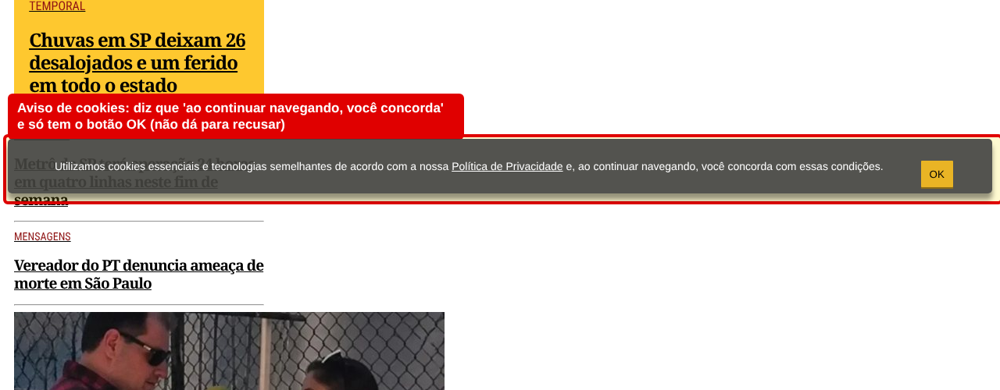

**O que são cookies?** São pequenos arquivos que o site guarda no aparelho do leitor. Alguns fazem o site funcionar; outros servem para **mostrar anúncios** e **contar a audiência**.

**O que está errado:** o aviso diz *"ao continuar navegando, você concorda"* e só tem o botão **OK**.

**Por que é um problema:** é como dizer que quem entrou na loja concordou em ser filmado. A lei exige que o leitor **possa dizer não**. Ficar no site não é dizer sim.

**Como corrigir:** um aviso com três botões, **Aceitar · Recusar · Personalizar**, com o mesmo destaque para aceitar e recusar.

<small>Base: LGPD, art. 5º, XII · Guia de Cookies da ANPD</small>

---

## 2. Ferramentas de anúncio ligadas antes da autorização 🔴

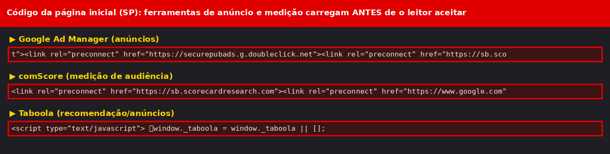

**O que está errado:** assim que a página abre, já são carregadas as ferramentas do Google (anúncios e estatística), do comScore (audiência) e do Taboola. **O leitor ainda nem clicou em nada.**

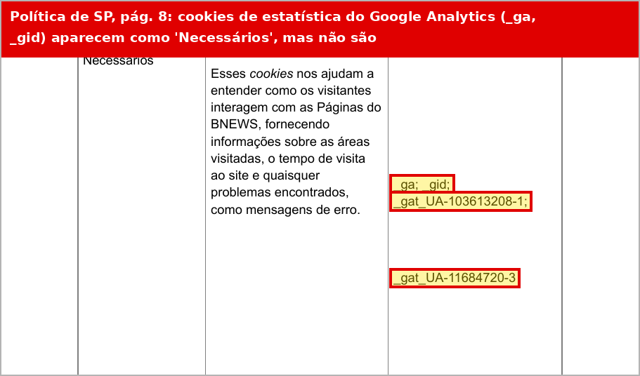

**E tem mais:** a própria política de SP classifica os cookies do **Google Analytics** (estatística) como **"Necessários"**. Eles **não são necessários** para o site funcionar; servem para medir a audiência. Essa classificação errada é o que hoje "justifica" ligar tudo sem pedir permissão.

**Por que é um problema:** essas ferramentas só podem ser ligadas **depois** que o leitor autorizar.

**Como corrigir:**
- usar uma **ferramenta de consentimento** (há opções gratuitas ou baratas) que só ligue anúncios e estatística depois do "Aceitar";
- corrigir a tabela da política, passando o Google Analytics para "Estatística".

O Google tem um modo próprio que **preserva parte da receita** mesmo quando o leitor recusa.

<small>Base: LGPD, art. 7º, I · Guia de Cookies da ANPD</small>

---

## 3. Falta um responsável pelos dados 🔴

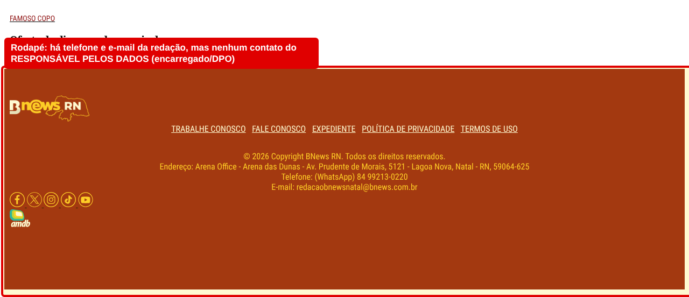

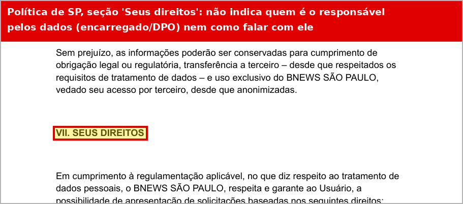

**O que está errado:** o rodapé tem o telefone e o e-mail da **redação**, e a política tem uma seção "Seus direitos", mas **nenhum dos dois diz quem é o responsável pelos dados** (o encarregado, ou DPO) nem como falar com ele.

**Por que é um problema:** um leitor que queira saber o que o BNews tem sobre ele, ou pedir para apagar o cadastro, não sabe a quem recorrer.

**Como corrigir:** nomear o encarregado (pode ser você) e publicar no rodapé e na política, por exemplo: *"Privacidade: privacidade@bnews..."*.

<small>Base: LGPD, art. 41 · Resolução ANPD nº 18/2024</small>

---

## 4. Links quebrados e nome da empresa errado nas políticas 🔴

**Os sites TÊM uma página "Fale Conosco" que funciona** (por exemplo, `bnewssaopaulo.com.br/fale-conosco.html`). O problema é que **as políticas não mandam o leitor para ela**.

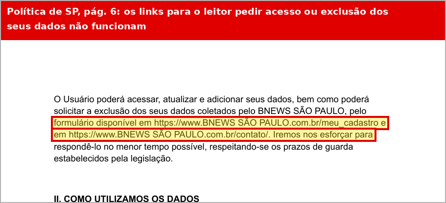

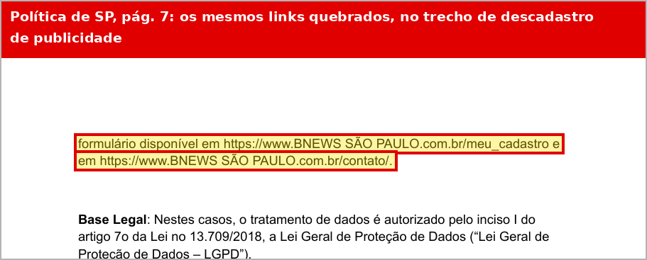

**Na política de SP**, nos dois trechos em que o leitor aprende a pedir acesso, exclusão ou descadastro, os links são `www.BNEWS SÃO PAULO.com.br/meu_cadastro` e `.../contato/`. Esses endereços **não existem**:

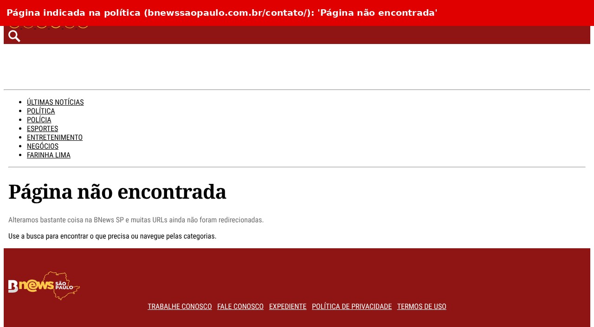

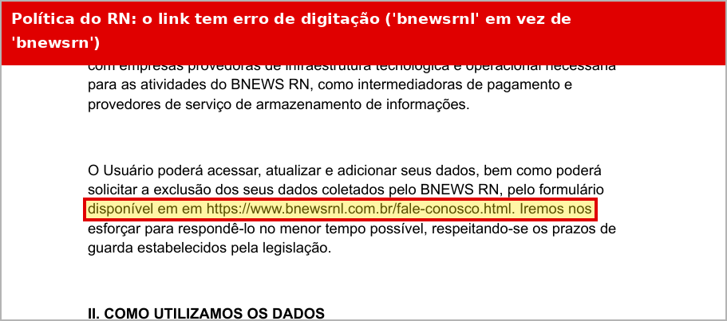

**Na política do RN**, o link tem um **erro de digitação**: `bnewsrnl` em vez de `bnewsrn`.

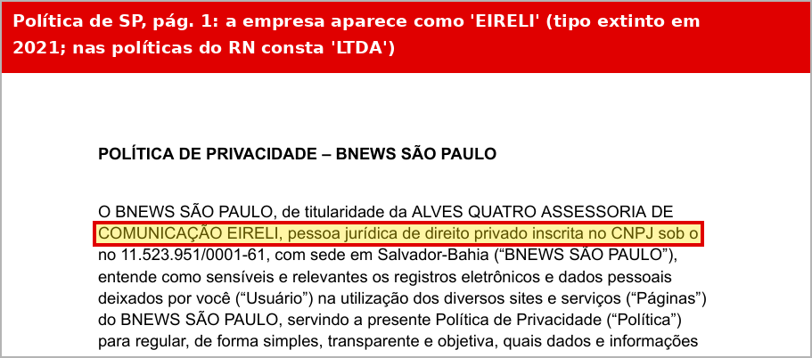

**O nome da empresa também está errado:** a política de SP diz **"EIRELI"**, um tipo de empresa que deixou de existir em 2021. As políticas do RN dizem "LTDA".

**Por que é um problema:** justamente no trecho em que o leitor aprende a exercer seus direitos, ele cai numa página de erro.

**Como corrigir:** trocar todos esses links pelo endereço do "Fale Conosco" de cada site (ou pelo e-mail do responsável pelos dados) e corrigir o nome da empresa conforme o cartão CNPJ.

<small>Base: LGPD, arts. 9º e 18</small>

---

## 5. O grupo de WhatsApp do RN 🔴

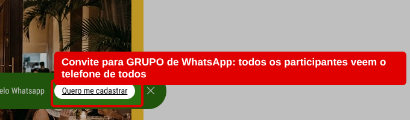

**O que está errado:** o botão "Quero me cadastrar" leva o leitor para um **grupo** de WhatsApp.

**Por que é um problema:** num grupo, **todo mundo vê o número de todo mundo**. Qualquer participante, inclusive golpistas, pode copiar os telefones dos leitores. Quem expôs os números foi o BNews.

**Como corrigir:** trocar o grupo por um **Canal do WhatsApp**, em que só o BNews publica e os números ficam escondidos. Custo zero.

<small>Base: LGPD, arts. 6º e 46</small>

---

## 6. As Ofertas não avisam da comissão 🔴 (regra de publicidade)

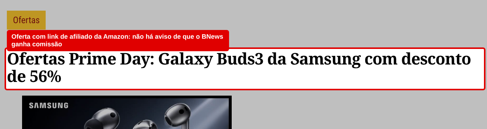

**O que está errado:** as Ofertas levam o leitor para a Amazon com um código do BNews. Quando ele compra, **o BNews ganha comissão**, e o texto não avisa isso em lugar nenhum.

**Por que é um problema:** o leitor acha que é notícia, mas é publicidade. A **Amazon exige esse aviso** e pode cancelar o programa, e o BNews perderia essa receita.

**Como corrigir:** colocar no topo de cada oferta: *"Link de afiliado: o BNews pode ganhar comissão se você comprar por aqui."*

<small>Base: CDC, art. 36 · CONAR</small>

---

## 7. O formulário "Fale Conosco" 🟡

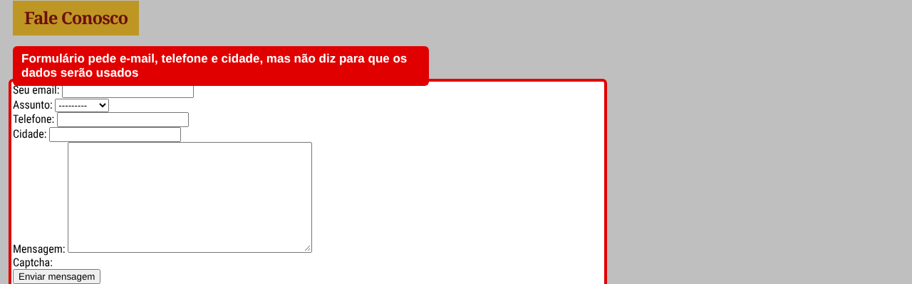

**O que está errado:** o formulário pede e-mail, telefone, cidade e mensagem, mas **não diz para que** esses dados serão usados.

**Como corrigir:** colocar embaixo do botão: *"Usaremos seus dados só para responder sua mensagem. Veja nossa Política de Privacidade."* Também vale pensar se o telefone e a cidade são realmente necessários.

<small>Base: LGPD, art. 9º</small>

---

## 8. Dados que vão para fora do Brasil 🟡

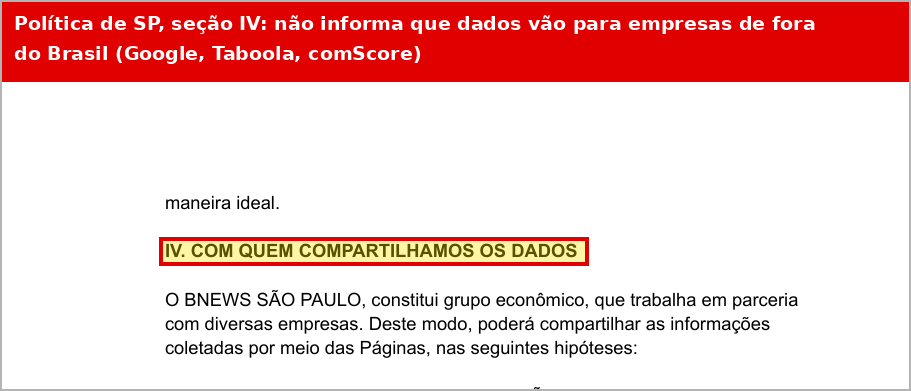

**O que está errado:** a seção "Com quem compartilhamos os dados" **não conta** que Google, Taboola e comScore são empresas estrangeiras e que os dados vão para fora do país.

**Por que é um problema:** a lei permite isso, desde que haja um **contrato com garantias** e que o leitor **seja avisado**.

**Como corrigir:** conferir os contratos desses fornecedores e incluir na política quais são e que os dados podem ser armazenados fora do Brasil.

<small>Base: LGPD, arts. 33 a 36 · Resolução ANPD nº 19/2024</small>

---

## 9. Duas políticas diferentes no RN 🟡

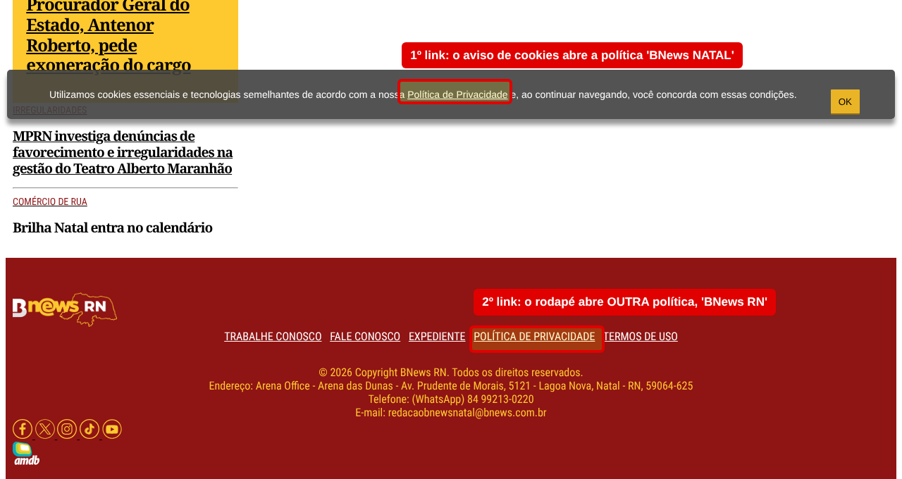

**O que está errado:** no site do RN, o aviso de cookies abre a política **"BNews NATAL"** e o rodapé abre **outra**, a **"BNews RN"**.

**Como corrigir:** fazer **uma política só para todo o grupo BNews**, usada em todos os sites e em todos os links.

---

## 10. Políticas em PDF e sem data 🟡

**O que está errado:** as políticas são arquivos PDF e **não dizem quando foram atualizadas**.

**Como corrigir:** publicar a política como uma **página normal do site**, com *"Última atualização: [data]"* no topo.

---

## 11. Termos de uso que mudam "sem aviso" 🟡

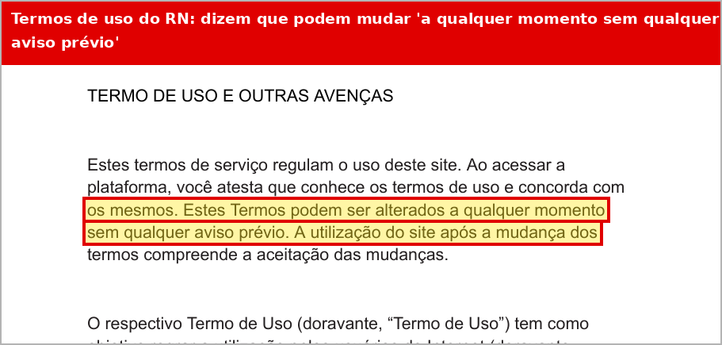

**O que está errado:** os termos do RN dizem que podem ser alterados *"a qualquer momento sem qualquer aviso prévio"*.

**Como corrigir:** trocar por *"Os termos podem ser atualizados. A data da última versão fica no topo e mudanças importantes serão avisadas no site."*

---

## 12. Newsletter e notificações (Bahia) 🟡 Verificar
As páginas internas do site da Bahia bloqueiam a leitura automática, por isso não há print. **O que conferir manualmente:**
- [ ] O cadastro da newsletter explica para que o e-mail será usado?
- [ ] Cada e-mail enviado tem o link **"Descadastrar"**?
- [ ] Existe contrato com a plataforma de envio?

---

## Por onde começar

| Quando | O que fazer | Custo |
|---|---|---|
| **Semana 1** | Corrigir links e nome da empresa nas políticas (4) · trocar o grupo pelo Canal de WhatsApp (5) · aviso nas Ofertas (6) | Zero |
| **Semanas 2 e 3** | Nomear o responsável pelos dados (3) · política única, com data, aviso no formulário e termos corrigidos (7, 9, 10, 11) | Zero |
| **Semanas 2 a 4** | Novo aviso de cookies com "Recusar", ferramentas ligadas só depois do aceite e Google Analytics reclassificado (1, 2) | Baixo (equipe de tecnologia) |
| **Mês 2** | Fornecedores de fora do Brasil e newsletter (8, 12) | Zero |
