# Revisão de adequação: sites BNews

**Data da verificação:** 13/11/2026
**Sites:** BNews São Paulo, BNews RN e BNews Bahia (página inicial e cadastro da newsletter)
**Fontes normativas:** Lei nº 13.709/2018 (LGPD), Lei nº 8.078/1990 (CDC), normas e orientações da ANPD e Lei nº 14.195/2021, conforme a Seção III.
**Nos prints, o que precisa ser corrigido está marcado em vermelho.**

---

# SEÇÃO I: PROTEÇÃO DE DADOS PESSOAIS (LGPD)

## Por que a LGPD se aplica aos sites

> **Art. 4º** Esta Lei não se aplica ao tratamento de dados pessoais: [...] II – realizado para fins **exclusivamente**: a) jornalístico e artísticos [...]

A exceção vale apenas para o tratamento feito **exclusivamente** para fins jornalísticos. A coleta de dados para anúncios, estatísticas de audiência, formulários e grupos de mensagens não tem finalidade exclusivamente jornalística e, por isso, **está sujeita à LGPD**.

---

## Resumo da Seção I

| # | Ponto a adequar | Prioridade |
|---|---|---|
| 1 | Aviso de cookies trata "continuar navegando" como concordância | Alta |
| 2 | Ferramentas de anúncio e de estatística são carregadas antes de qualquer manifestação do leitor | Alta |
| 3 | Não há indicação do encarregado pelo tratamento de dados | Alta |
| 4 | As políticas indicam links de contato que não funcionam e trazem a identificação da empresa divergente | Alta |
| 5 | Grupo de WhatsApp expõe o telefone dos leitores aos demais participantes | Alta |
| 6 | O formulário "Fale Conosco" não informa a finalidade dos dados coletados | Média |
| 7 | A política não identifica as empresas parceiras nem informa sobre transferência internacional | Média |
| 8 | O site do RN mantém duas políticas de privacidade diferentes | Média |
| 9 | As políticas não informam a data da última atualização | Média |
| 10 | Os termos de uso preveem alteração "sem qualquer aviso prévio" | Média |
| 11 | O cadastro da newsletter não identifica o controlador nem remete à Política de Privacidade | Média |

---

## 1. Aviso de cookies

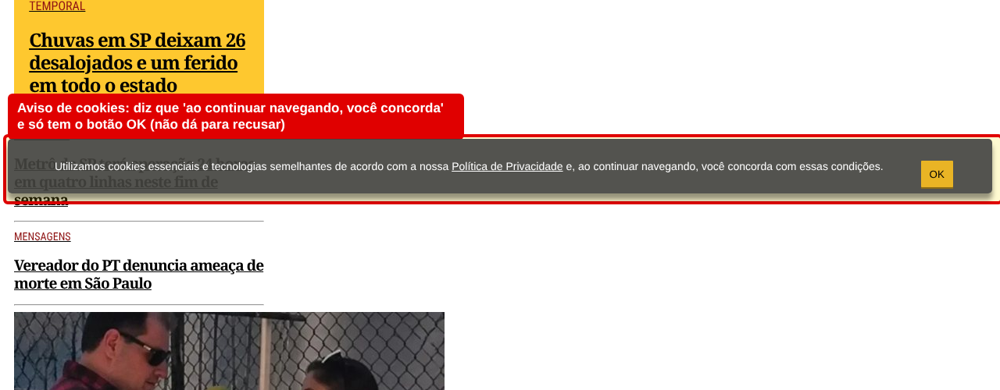

**O que foi verificado:** o aviso diz *"Utilizamos cookies essenciais e tecnologias semelhantes de acordo com a nossa Política de Privacidade e, ao continuar navegando, você concorda com essas condições"*. Há um único botão, **"OK"**, e nenhuma opção de recusa. O mesmo aviso aparece nos sites de SP, do RN e da Bahia.

**Por que adequar:** a própria Política de Privacidade do BNews informa que a base legal para o uso de cookies é o **consentimento** (art. 7º, I). A LGPD exige que o consentimento seja uma manifestação inequívoca, e permanecer no site não é manifestação de vontade. Além disso, o aviso fala só em cookies "essenciais", mas o site usa cookies de anúncio e de estatística (ponto 2). Uma informação imprecisa torna o consentimento nulo.

**O que diz a LGPD:**
> **Art. 5º, XII** – consentimento: manifestação livre, informada e inequívoca pela qual o titular concorda com o tratamento de seus dados pessoais para uma finalidade determinada;
>
> **Art. 8º, § 2º** Cabe ao controlador o ônus da prova de que o consentimento foi obtido em conformidade com o disposto nesta Lei.
>
> **Art. 9º, § 1º** Na hipótese em que o consentimento é requerido, esse será considerado nulo caso as informações fornecidas ao titular tenham conteúdo enganoso ou abusivo ou não tenham sido apresentadas previamente com transparência, de forma clara e inequívoca.
>
> **Art. 18, VIII** – informação sobre a possibilidade de não fornecer consentimento e sobre as consequências da negativa;

**Como adequar:** substituir o aviso por um que ofereça as opções **Aceitar**, **Recusar** e **Personalizar**, descreva corretamente os tipos de cookies usados e registre a escolha do leitor.

---

## 2. Ferramentas de anúncio e estatística carregadas antes da manifestação do leitor

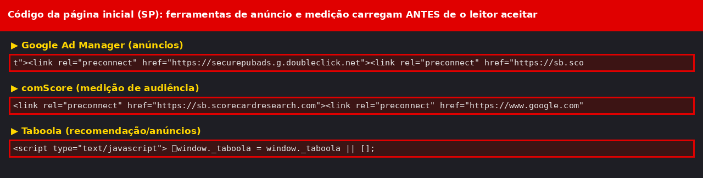

**O que foi verificado:** o código da página inicial carrega o Google Ad Manager (anúncios), o Google Analytics (estatística) e o comScore (medição de audiência) nos três sites, além do Taboola. O site da Bahia também carrega o OneSignal (notificações). Esse carregamento acontece ao abrir a página, antes de qualquer clique do leitor.

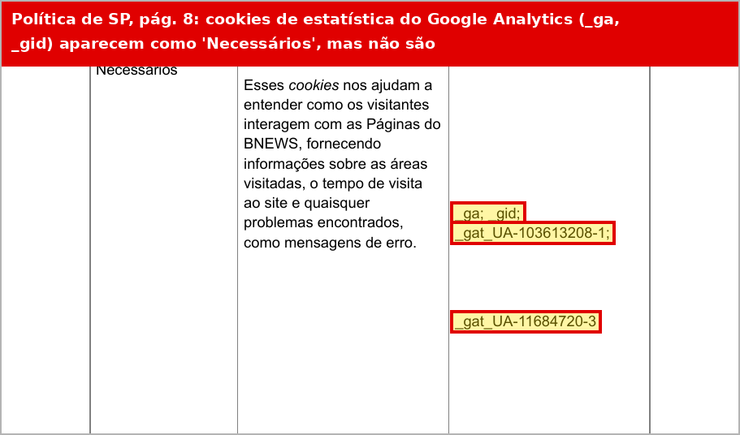

**O que foi verificado na política:** a Política de Privacidade de SP classifica os cookies do Google Analytics (_ga, _gid) como **"Necessários"**, mas a própria descrição da política diz que eles servem para *"entender como os visitantes interagem com as Páginas"*, ou seja, para estatística.

**Por que adequar:** se a base legal é o consentimento, como diz a política, o tratamento só pode começar depois dele. A classificação dos cookies de estatística como "necessários" não corresponde à finalidade descrita na própria política.

**O que diz a LGPD:**
> **Art. 7º** O tratamento de dados pessoais somente poderá ser realizado nas seguintes hipóteses: I – mediante o fornecimento de consentimento pelo titular; [...]
>
> **Art. 6º, VI** – transparência: garantia, aos titulares, de informações claras, precisas e facilmente acessíveis sobre a realização do tratamento e os respectivos agentes de tratamento [...]

**Como adequar:**
- carregar as ferramentas de anúncio e de estatística **somente após o consentimento** do leitor;
- corrigir a tabela de cookies da política, reclassificando o Google Analytics conforme a finalidade descrita.

---

## 3. Encarregado pelo tratamento de dados não indicado

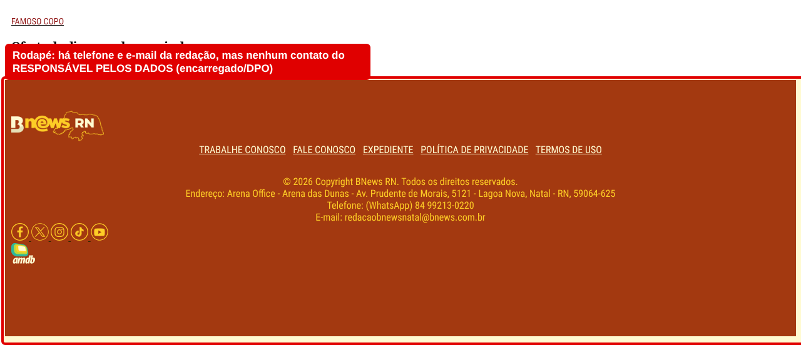

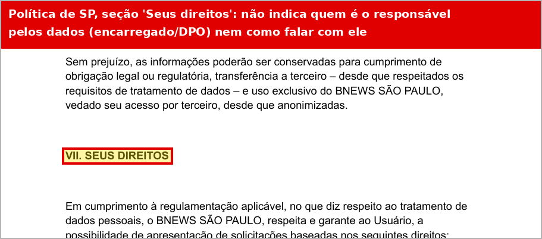

**O que foi verificado:** o rodapé dos sites traz o telefone e o e-mail da redação, e a política tem uma seção "Seus direitos", mas **nenhum dos dois identifica o encarregado** nem informa o contato dele.

**Por que adequar:** a lei exige a indicação do encarregado e a divulgação pública da identidade e do contato dele.

**O que diz a LGPD:**
> **Art. 41.** O controlador deverá indicar encarregado pelo tratamento de dados pessoais.
> **§ 1º** A identidade e as informações de contato do encarregado deverão ser divulgadas publicamente, de forma clara e objetiva, preferencialmente no sítio eletrônico do controlador.
> **§ 3º** A autoridade nacional poderá estabelecer normas complementares sobre a definição e as atribuições do encarregado, inclusive hipóteses de dispensa da necessidade de sua indicação, conforme a natureza e o porte da entidade ou o volume de operações de tratamento de dados.

**Como adequar:** indicar formalmente o encarregado e publicar o nome e o contato dele no rodapé dos sites e na Política de Privacidade.

---

## 4. Links de contato que não funcionam e identificação divergente da empresa

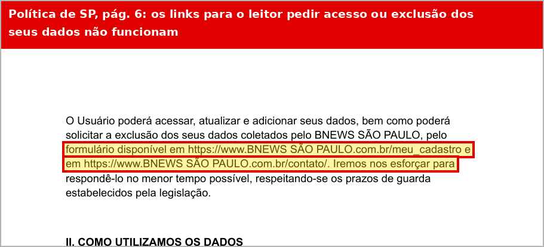

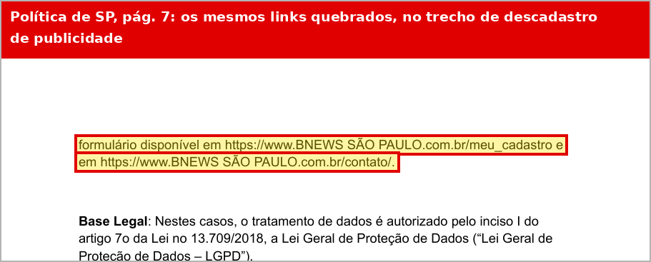

**O que foi verificado:** nos trechos que explicam como o leitor pode acessar, corrigir ou excluir seus dados e como cancelar o recebimento de publicidade, a política de SP indica os endereços `https://www.BNEWS SÃO PAULO.com.br/meu_cadastro` e `https://www.BNEWS SÃO PAULO.com.br/contato/`. Os dois endereços não funcionam.

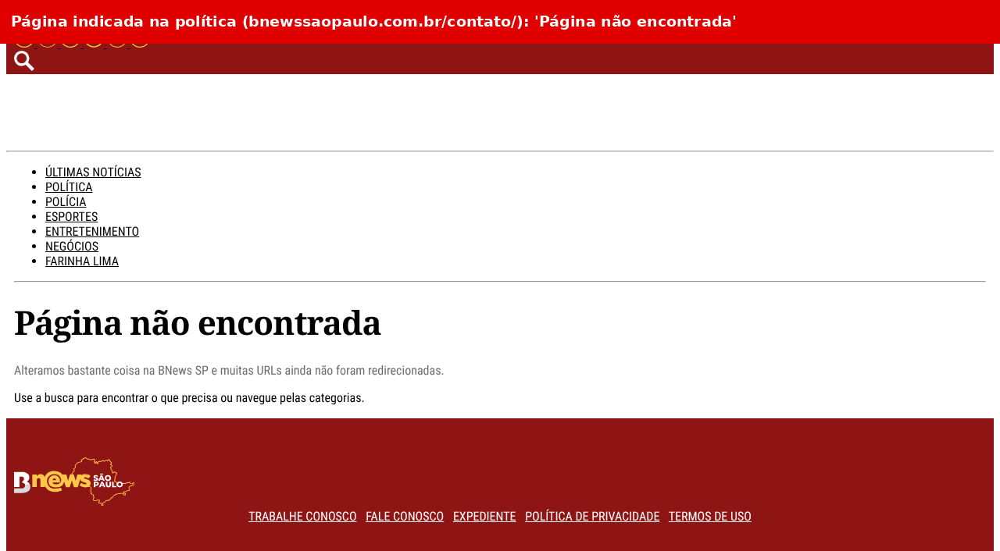

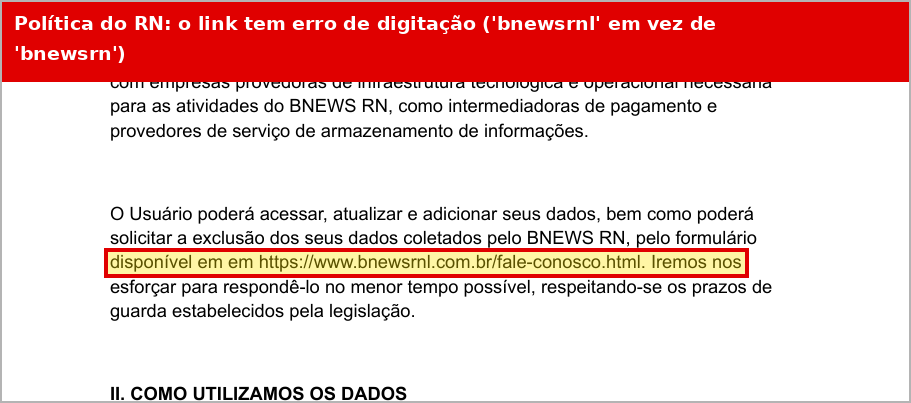

**Na política do RN**, o mesmo trecho indica `www.bnewsrnl.com.br/fale-conosco.html`, com erro de digitação ("bnewsrnl"). A página "Fale Conosco" correta existe nos dois sites (`bnewssaopaulo.com.br/fale-conosco.html` e `bnewsrn.com.br/fale-conosco.html`), mas não é a indicada nesses trechos.

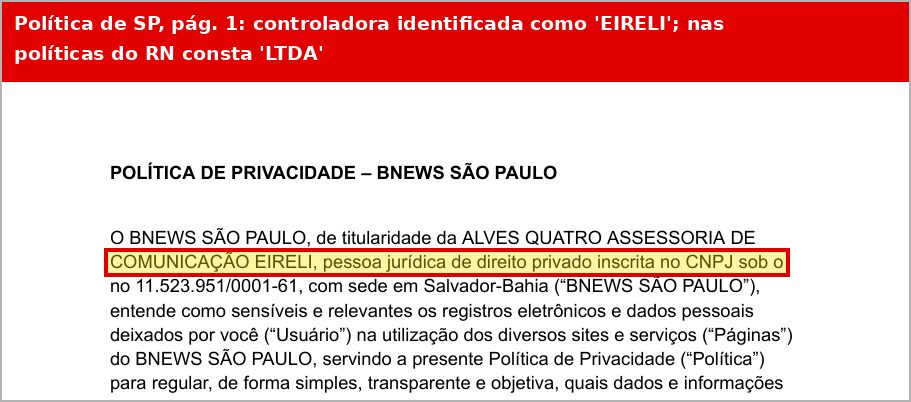

**Identificação da empresa:** a política de SP identifica a controladora como *"ALVES QUATRO ASSESSORIA DE COMUNICAÇÃO **EIRELI**"*, e as políticas do RN como *"...**LTDA**"*, com a mesma raiz de CNPJ (11.523.951).

**O que diz a LGPD:**
> **Art. 9º** O titular tem direito ao acesso facilitado às informações sobre o tratamento de seus dados [...]: III – identificação do controlador; IV – informações de contato do controlador; [...] VII – direitos do titular, com menção explícita aos direitos contidos no art. 18 desta Lei.
>
> **Art. 8º, § 5º** O consentimento pode ser revogado a qualquer momento mediante manifestação expressa do titular, por procedimento gratuito e facilitado [...]
>
> **Art. 18, § 5º** O requerimento referido no § 3º deste artigo será atendido sem custos para o titular, nos prazos e nos termos previstos em regulamento.

**Como adequar:**
- substituir os links pelo endereço correto do "Fale Conosco" de cada site ou pelo contato do encarregado;
- conferir a razão social no cartão CNPJ e uniformizá-la em todas as políticas.

---

## 5. Grupo de WhatsApp

**O que foi verificado:** no site do RN, o botão "Quero me cadastrar" leva a um **grupo** de WhatsApp (link do tipo `chat.whatsapp.com`). Em um grupo, o número de telefone de cada participante fica visível para os demais.

**Por que adequar:** ao reunir leitores em um grupo, o BNews torna o telefone de cada um acessível a terceiros, sem finalidade informada e sem medida de proteção.

**O que diz a LGPD:**
> **Art. 6º, VII** – segurança: utilização de medidas técnicas e administrativas aptas a proteger os dados pessoais de acessos não autorizados e de situações acidentais ou ilícitas de destruição, perda, alteração, comunicação ou difusão;
>
> **Art. 46.** Os agentes de tratamento devem adotar medidas de segurança, técnicas e administrativas aptas a proteger os dados pessoais de acessos não autorizados e de situações acidentais ou ilícitas de destruição, perda, alteração, comunicação ou qualquer forma de tratamento inadequado ou ilícito.

**Como adequar:** substituir o grupo por um meio em que o telefone dos leitores não fique visível a outros participantes (por exemplo, o Canal do WhatsApp) e informar a finalidade do cadastro.

---

## 6. Formulário "Fale Conosco"

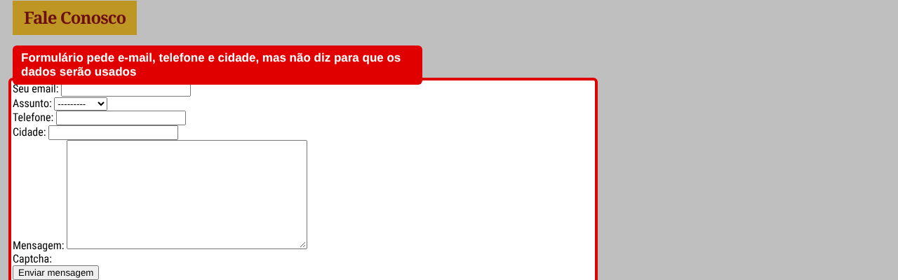

**O que foi verificado:** o formulário coleta e-mail, assunto, telefone, cidade e mensagem e não informa a finalidade da coleta nem remete à Política de Privacidade.

**O que diz a LGPD:**
> **Art. 6º, I** – finalidade: realização do tratamento para propósitos legítimos, específicos, explícitos e informados ao titular [...]
>
> **Art. 6º, III** – necessidade: limitação do tratamento ao mínimo necessário para a realização de suas finalidades [...]
>
> **Art. 9º, I** – finalidade específica do tratamento;

**Como adequar:**
- incluir junto ao formulário a informação da finalidade (por exemplo: *"Os dados informados serão usados para responder à sua mensagem."*) e o link para a Política de Privacidade;
- avaliar se o telefone e a cidade são necessários para essa finalidade.

---

## 7. Empresas parceiras e transferência internacional

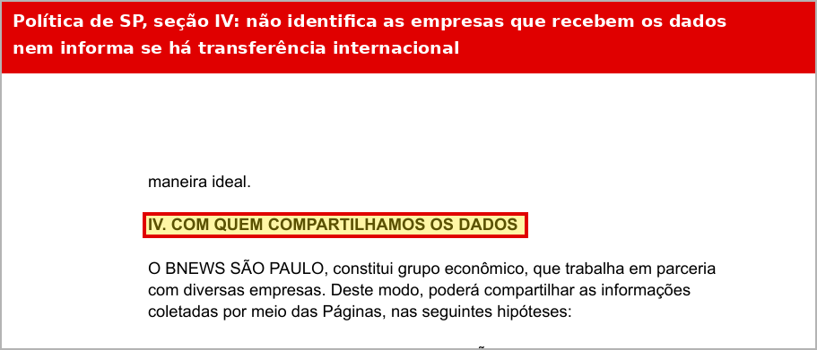

**O que foi verificado:** a seção "Com quem compartilhamos os dados" da política não identifica as empresas que recebem os dados dos leitores (o código do site carrega ferramentas do Google, do comScore e do Taboola) e não informa se há transferência internacional desses dados.

**O que diz a LGPD:**
> **Art. 9º, V** – informações acerca do uso compartilhado de dados pelo controlador e a finalidade;
>
> **Art. 18, VII** – informação das entidades públicas e privadas com as quais o controlador realizou uso compartilhado de dados;
>
> **Art. 33.** A transferência internacional de dados pessoais somente é permitida nos seguintes casos: [...] II – quando o controlador oferecer e comprovar garantias de cumprimento dos princípios, dos direitos do titular e do regime de proteção de dados previstos nesta Lei, na forma de: [...] b) cláusulas-padrão contratuais; [...] VIII – quando o titular tiver fornecido o seu consentimento específico e em destaque para a transferência, com informação prévia sobre o caráter internacional da operação [...]

**Como adequar:**
- identificar na política as empresas parceiras e a finalidade do compartilhamento;
- verificar nos contratos e termos dessas empresas se há transferência internacional e em qual hipótese do art. 33 ela se enquadra.

---

## 8. Duas políticas de privacidade no site do RN

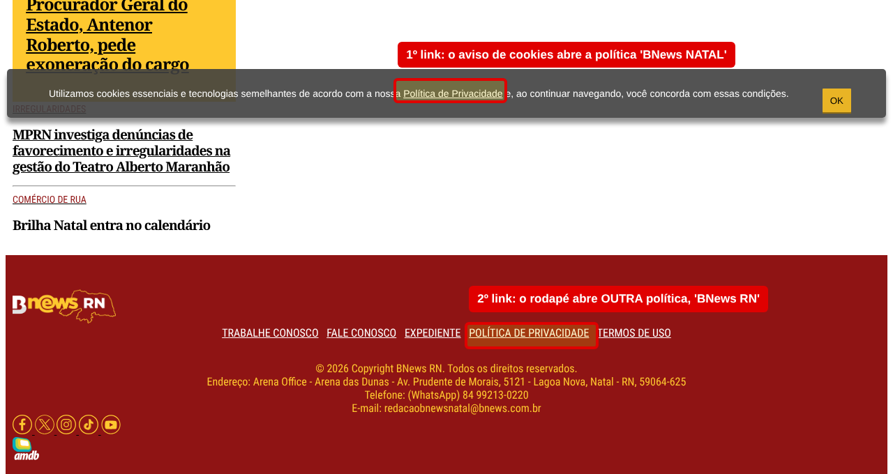

**O que foi verificado:** no site do RN, o aviso de cookies abre a política "BNews NATAL" e o rodapé abre outra, a "BNews RN".

**O que diz a LGPD:**
> **Art. 6º, VI** – transparência: garantia, aos titulares, de informações claras, precisas e facilmente acessíveis [...]

**Como adequar:** manter uma única Política de Privacidade, usada em todos os links do site.

---

## 9. Políticas sem data de atualização

**O que foi verificado:** as políticas de SP e do RN são publicadas em PDF e não informam a data da última atualização.

**O que diz a LGPD:**
> **Art. 8º, § 6º** Em caso de alteração de informação referida nos incisos I, II, III ou V do art. 9º desta Lei, o controlador deverá informar ao titular, com destaque de forma específica do teor das alterações [...]

**Como adequar:** informar no início da política a data da última atualização e destacar as alterações quando houver.

---

## 10. Termos de uso

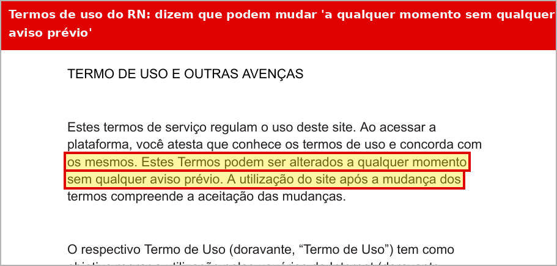

**O que foi verificado:** os termos de uso do RN dizem: *"Estes Termos podem ser alterados a qualquer momento sem qualquer aviso prévio."*

**O que diz a LGPD:**
> **Art. 9º, § 2º** Na hipótese em que o consentimento é requerido, se houver mudanças da finalidade para o tratamento de dados pessoais não compatíveis com o consentimento original, o controlador deverá informar previamente o titular sobre as mudanças de finalidade, podendo o titular revogar o consentimento, caso discorde das alterações.

**Como adequar:** prever que as alterações relevantes serão informadas previamente ao leitor e indicar a data da versão em vigor.

---

## 11. Cadastro da newsletter (BNews Bahia)

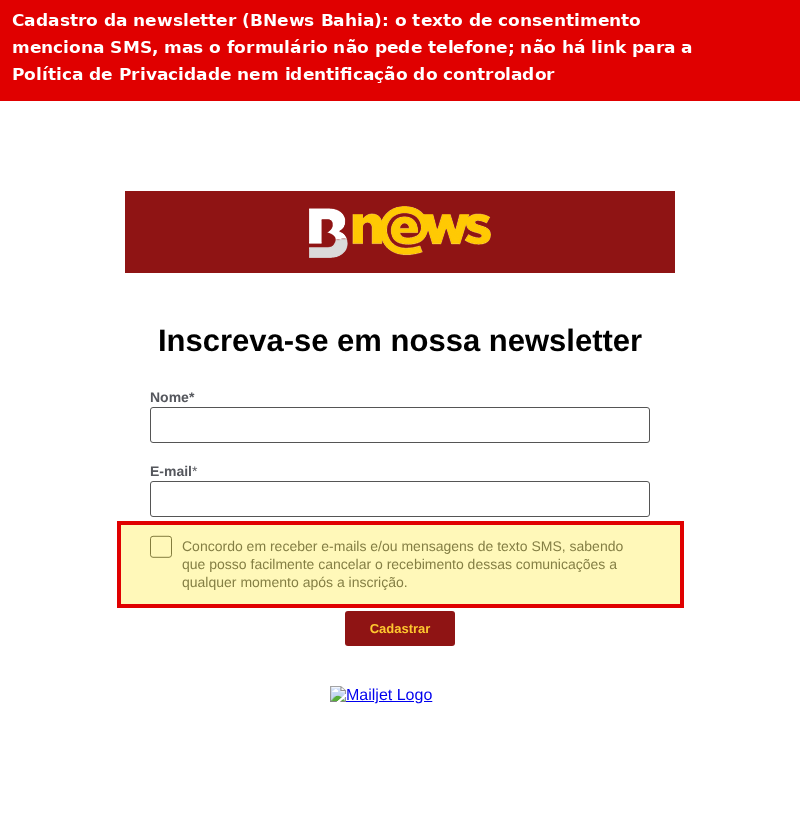

**O que foi verificado:** o site do BNews Bahia leva ao cadastro da newsletter, hospedado em `cadastro.newsletterbnews.com.br` (formulário da plataforma Mailjet). O formulário coleta **nome** e **e-mail** e traz uma caixa de concordância, **desmarcada e obrigatória**, com o texto: *"Concordo em receber e-mails e/ou mensagens de texto SMS, sabendo que posso facilmente cancelar o recebimento dessas comunicações a qualquer momento após a inscrição."*

**Pontos a adequar:**
- a página **não identifica o controlador** (a empresa responsável pelos dados) nem traz seu contato;
- **não há link para a Política de Privacidade**;
- o texto menciona **SMS**, mas o formulário **não coleta telefone**, o que torna imprecisa a finalidade informada;
- o formulário é operado por uma plataforma terceirizada (Mailjet), que deve tratar os dados conforme as instruções do controlador.

**O que está adequado:** a caixa de concordância vem **desmarcada** e é de marcação obrigatória, e o texto informa que o cancelamento pode ser feito a qualquer momento.

**O que diz a LGPD:**
> **Art. 9º** O titular tem direito ao acesso facilitado às informações sobre o tratamento de seus dados [...]: I – finalidade específica do tratamento; [...] III – identificação do controlador; IV – informações de contato do controlador; [...]
>
> **Art. 8º, § 4º** O consentimento deverá referir-se a finalidades determinadas, e as autorizações genéricas para o tratamento de dados pessoais serão nulas.
>
> **Art. 39.** O operador deverá realizar o tratamento segundo as instruções fornecidas pelo controlador, que verificará a observância das próprias instruções e das normas sobre a matéria.

**Como adequar:**
- identificar o controlador e o contato do encarregado na página de cadastro e incluir o link para a Política de Privacidade;
- ajustar o texto de concordância para as finalidades efetivamente praticadas (retirar a menção a SMS, se não houver coleta de telefone);
- verificar o contrato com a plataforma de envio quanto às instruções de tratamento.

---

# SEÇÃO II: PUBLICIDADE (CÓDIGO DE DEFESA DO CONSUMIDOR)

## 12. Ofertas com link de afiliado sem identificação como publicidade

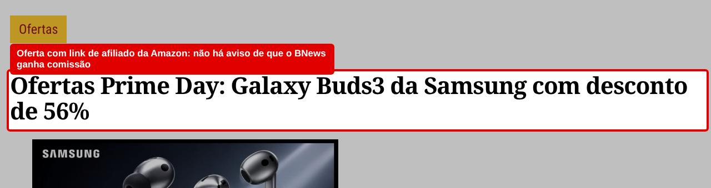

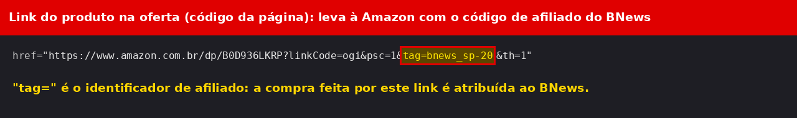

**O que foi verificado:** a seção "Ofertas" dos sites de SP e do RN publica textos sobre produtos com desconto, assinados por "Redação". Na oferta verificada, o link do produto leva à Amazon com o identificador de afiliado do BNews (`tag=bnews_sp-20`). O texto não informa que se trata de conteúdo comercial nem que o BNews pode ser remunerado pelas compras feitas pelo link.

**Por que adequar:** o conteúdo tem finalidade comercial, mas é apresentado no formato e com a assinatura de uma matéria jornalística. Assim, o leitor não consegue identificá-lo, de forma fácil e imediata, como publicidade.

**O que diz o Código de Defesa do Consumidor:**
> **Art. 6º** São direitos básicos do consumidor: [...] III - a informação adequada e clara sobre os diferentes produtos e serviços [...]; IV - a proteção contra a publicidade enganosa e abusiva, métodos comerciais coercitivos ou desleais [...]
>
> **Art. 36.** A publicidade deve ser veiculada de tal forma que o consumidor, fácil e imediatamente, a identifique como tal.
>
> **Art. 37, § 3º** Para os efeitos deste código, a publicidade é enganosa por omissão quando deixar de informar sobre dado essencial do produto ou serviço.

**Como adequar:**
- identificar cada oferta, no topo do texto, como conteúdo publicitário com link de afiliado (por exemplo: *"Conteúdo publicitário: o BNews pode receber comissão por compras feitas pelos links desta página."*);
- substituir a assinatura "Redação" por uma identificação que não confunda o conteúdo comercial com o jornalístico.

---

# SEÇÃO III: NORMAS COMPLEMENTARES (ANPD E LEGISLAÇÃO CORRELATA)

Esta seção reúne as normas e orientações oficiais que complementam a LGPD nos pontos tratados acima.

## III.1 Guia Orientativo "Cookies e proteção de dados pessoais" (ANPD, outubro de 2022)
**Relaciona-se com os pontos 1 e 2.**

> *"[...] não é recomendável a utilização de banners de cookies com opções de autorização pré-selecionadas ou a adoção de mecanismos de consentimento tácito, como a pressuposição de que, ao continuar a navegação em uma página, o titular forneceria consentimento para o tratamento de seus dados pessoais."* (p. 19)
>
> *"Disponibilizar botão que permita rejeitar todos os cookies não necessários, de fácil visualização, nos banners de primeiro e segundo nível."* (p. 30)
>
> *"[...] o consentimento pode ser considerado uma hipótese legal mais apropriada para o uso de cookies de publicidade [...]. Essa conclusão é reforçada ao se considerar que os cookies de publicidade são classificados como não necessários [...]"* (p. 25)
>
> *"A utilização de cookies para fins de medição de audiência (cookies analíticos ou de medição) pode ser amparada na hipótese legal do legítimo interesse em determinados contextos, observados, em qualquer hipótese, os requisitos previstos na lgpd."* (p. 24)

**Aplicação:** o aviso atual (ponto 1) adota o consentimento tácito, que o Guia considera não recomendável, e não oferece o botão de rejeição. Para os cookies de **publicidade**, o Guia indica o consentimento como hipótese mais apropriada. Para os cookies de **medição de audiência** (Google Analytics, comScore), o Guia admite o **legítimo interesse** em determinados contextos. Se o BNews optar por essa hipótese, a Política de Privacidade deverá informá-la, já que hoje indica o consentimento.

## III.2 Resolução CD/ANPD nº 2/2022: agentes de tratamento de pequeno porte
**Relaciona-se com o ponto 3.** Vigente, com alterações pela Resolução CD/ANPD nº 15/2024, segundo a página oficial da ANPD.

> **Art. 11.** Os agentes de tratamento de pequeno porte não são obrigados a indicar o encarregado pelo tratamento de dados pessoais exigido no art. 41 da LGPD.
> **§ 1º** O agente de tratamento de pequeno porte que não indicar um encarregado deve disponibilizar um canal de comunicação com o titular de dados para atender o disposto no art. 41, § 2º, I da LGPD.
>
> **Art. 3º** Não poderão se beneficiar do tratamento jurídico diferenciado previsto neste Regulamento os agentes de tratamento de pequeno porte que: I - realizem tratamento de alto risco para os titulares [...]; II - aufiram receita bruta superior ao limite estabelecido no art. 3º, II, da Lei Complementar nº 123, de 2006 [...]; ou III - pertençam a grupo econômico de fato ou de direito, cuja receita global ultrapasse os limites referidos no inciso II [...]

**Aplicação:** a dispensa de encarregado depende de o BNews se enquadrar como agente de pequeno porte e de não incidir nas exclusões do art. 3º (alto risco, receita bruta ou grupo econômico). **É preciso verificar a receita bruta da empresa e do grupo.** Mesmo com a dispensa, o canal de comunicação com o titular é obrigatório.

## III.3 Resolução CD/ANPD nº 18/2024: atuação do encarregado
**Relaciona-se com o ponto 3.**

> **Art. 3º** A indicação do encarregado deve ser realizada por ato formal do agente de tratamento, do qual constem as formas de atuação e as atividades a serem desempenhadas.
> **§ 1º** Entende-se por ato formal o documento escrito, datado e assinado [...]
>
> **Art. 9º** A identidade e as informações de contato do encarregado deverão ser divulgadas publicamente, de forma clara e objetiva, em local de destaque e de fácil acesso, no sítio eletrônico do agente de tratamento [...]
> **§ 1º** A divulgação da identidade do encarregado abrangerá, no mínimo: I - o nome completo, se for pessoa natural; [...]

**Aplicação:** se o encarregado for indicado, a indicação deve ser feita por **documento escrito, datado e assinado**, e o nome completo e o contato devem ficar em **local de destaque** no site.

## III.4 Resolução CD/ANPD nº 19/2024: transferência internacional de dados
**Relaciona-se com o ponto 7.** Vigente, com as alterações da retificação de 18/08/2025, segundo a página oficial da ANPD.

> **Art. 5º** A transferência internacional de dados será caracterizada quando o exportador transferir dados pessoais para o importador.
>
> **Art. 6º** A coleta internacional de dados não caracteriza transferência internacional de dados.
>
> **Art. 3º, V** – coleta internacional de dados: coleta de dados pessoais do titular efetuada diretamente pelo agente de tratamento localizado no exterior;
>
> **Art. 2º, parágrafo único.** Os agentes de tratamento que utilizam cláusulas contratuais para realizar transferências internacionais de dados deverão incorporar as cláusulas-padrão contratuais aprovadas pela ANPD aos seus respectivos instrumentos contratuais, no prazo de até 12 (doze) meses, contados da data de publicação desta Resolução.

**Aplicação:** é preciso analisar, para cada empresa parceira (Google, comScore, Taboola, OneSignal, Mailjet), se o BNews **transfere** dados a ela (transferência internacional, que exige um mecanismo do art. 33 da LGPD, como as cláusulas-padrão) ou se a própria empresa **coleta diretamente** os dados do leitor (coleta internacional, que não caracteriza transferência). O prazo para incorporar as cláusulas-padrão aos contratos é de 12 meses contados da publicação da Resolução.

## III.5 Lei nº 14.195/2021: transformação das EIRELI
**Relaciona-se com o ponto 4.**

> **Art. 41.** As empresas individuais de responsabilidade limitada existentes na data da entrada em vigor desta Lei serão transformadas em sociedades limitadas unipessoais independentemente de qualquer alteração em seu ato constitutivo.

**Aplicação:** a política de SP identifica a controladora como "EIRELI", tipo societário que a lei transformou em sociedade limitada unipessoal. A identificação deve ser atualizada conforme o cartão CNPJ.

## Fontes oficiais consultadas
- Lei nº 13.709/2018 (LGPD), texto atual: normas.leg.br (Senado Federal)
- Lei nº 8.078/1990 (CDC), compilação vigente: normas.leg.br (Senado Federal)
- Lei nº 14.195/2021: normas.leg.br (Senado Federal)
- Guia Orientativo "Cookies e proteção de dados pessoais", ANPD, out./2022: gov.br/anpd
- Resoluções CD/ANPD nº 2/2022 e nº 19/2024: página "Regulamentações da ANPD", gov.br/anpd
- Resolução CD/ANPD nº 18/2024: Diário Oficial da União (in.gov.br)

---

## Ordem sugerida de execução

| Etapa | Pontos | Responsáveis |
|---|---|---|
| 1 | Corrigir links e identificação da empresa nas políticas (4) · substituir o grupo de WhatsApp (5) · identificar as Ofertas como publicidade (12) | Jurídico e Redação |
| 2 | Indicar o encarregado (3) · política única, com data, informação no formulário e termos revisados (6, 8, 9, 10) | Jurídico |
| 3 | Novo aviso de cookies e carregamento das ferramentas somente após o consentimento (1, 2) | Tecnologia e Jurídico |
| 4 | Identificação das empresas parceiras e análise de transferência internacional (7) · ajustes no cadastro da newsletter (11) | Jurídico e Tecnologia |
